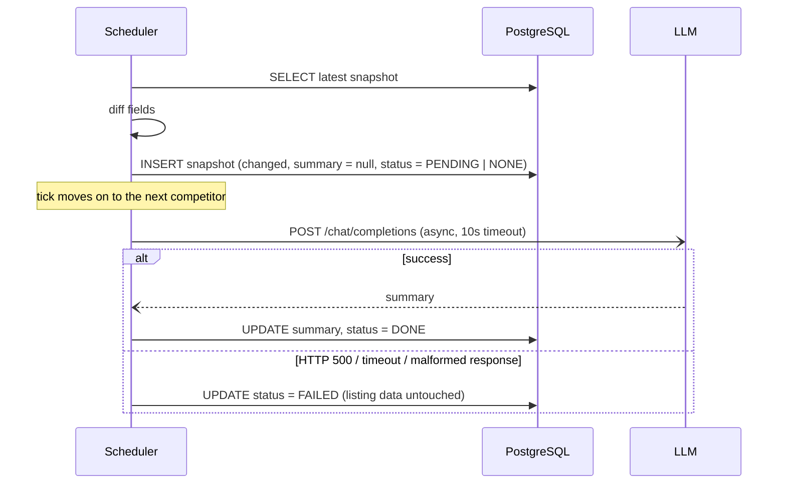

# CompetitorPulse

## Project Overview

**CompetitorPulse** tracks competitor product listings over time and explains, in plain English, what changed between two consecutive versions.

- A user adds or removes tracked competitors by id (e.g. `acme-crm`) via the UI or the REST API.
- A background scheduler periodically fetches each competitor's current listing (`title`, `tagline`, `price`, `description`) and **persists every snapshot**, so the full history is kept.
- When a listing differs from the previous snapshot, the backend asks an LLM for a short change summary (e.g. _"Price rose from $29/mo to $39/mo."_) and stores it on the new snapshot.
- A React UI shows the tracked competitors and a newest-first timeline for each one, with the raw fields, highlighted field-level changes, and the AI summary.

| Layer          | Technology                                              |
| -------------- | ------------------------------------------------------- |
| Backend        | NestJS 11 (TypeScript, strict mode), `@nestjs/schedule` |
| Persistence    | PostgreSQL 17, Prisma 6 (versioned SQL migrations)      |
| LLM            | Any OpenAI-compatible Chat Completions endpoint         |
| Frontend       | React 19, Vite, Tailwind CSS 4, served by Nginx         |
| Infrastructure | Docker Compose (db, mock-llm, backend, frontend)        |

---

## How to Run Locally

**Prerequisite:** Docker with Compose. Nothing else is needed: no Node, Python or API key.

```bash
docker compose up -d --build      # or: docker-compose up -d --build
```

On startup the backend waits for PostgreSQL to report healthy, applies pending migrations (`prisma migrate deploy`), and then starts the API and the scheduler.

| Service     | URL                          | Notes                                                     |
| ----------- | ---------------------------- | --------------------------------------------------------- |
| **UI**      | **http://localhost:8080**    | Nginx serves the SPA and proxies `/api` to the backend    |
| **API**     | **http://localhost:3000/api** | NestJS. Health check: `GET /api/health`                  |
| Mock LLM    | http://localhost:4001        | Published so you can inject failures from the host        |
| PostgreSQL  | `localhost:5432`             | `pulse` / `pulse`, database `competitor_pulse`            |

By default the scheduler polls **every 30 seconds**. For a faster demo, override the interval at startup:

```bash
POLL_CRON="*/5 * * * * *" docker compose up -d --build
```

To stop the stack, and optionally wipe the database volume:

```bash
docker compose down        # keep data
docker compose down -v     # also delete the Postgres volume
```

### API contract

| Method   | Path                              | Body               | Response                           |
| -------- | --------------------------------- | ------------------ | ---------------------------------- |
| `GET`    | `/api/competitors`                | –                  | `200` `[{ "id": string }, ...]`    |
| `POST`   | `/api/competitors`                | `{ "id": string }` | `201 Created`                      |
| `DELETE` | `/api/competitors/:id`            | –                  | `204 No Content`                   |
| `GET`    | `/api/competitors/:id/snapshots`  | –                  | `200` `[Snapshot, ...]`, newest first |

Additional endpoints and behavior:

- `GET /api/sources` lists the competitor ids the data source can serve. The UI uses it for suggestions.
- `GET /api/competitors/:id/snapshots?limit=N` caps the page size (default `200`, max `500`).
- Errors: `400` for an invalid or unknown id, `409` when the id is already tracked, `404` for an untracked competitor.

```bash
curl -i -X POST localhost:3000/api/competitors -H 'Content-Type: application/json' -d '{"id":"acme-crm"}'
curl -s localhost:3000/api/competitors/acme-crm/snapshots
```

### Inspecting the database with Prisma Studio

PostgreSQL is published on `localhost:5432`, so Prisma Studio can run from the host against the running stack:

```bash
cd backend
npm install                 # first time only
cp .env.example .env        # first time only; DATABASE_URL points at localhost:5432
npx prisma studio           # opens http://localhost:5555
```

### Running the backend outside Docker (optional)

```bash
docker compose up -d db mock-llm   # infrastructure only
cd backend
npm install && cp .env.example .env
npx prisma migrate deploy
npm run start:dev                  # API on :3000

cd ../frontend
npm install && npm run dev         # UI on :5173, proxies /api to :3000
```

---

## LLM Configuration

**The system uses the provided `mock-llm-server.py` out of the box, with zero configuration.** Docker Compose builds it as the `mock-llm` service, and the backend's default `LLM_BASE_URL` points to it (`http://mock-llm:4001/v1`). The mock does not generate real summaries. It echoes back a snippet of the prompt it received, which proves that real context is being sent.

### Using a real provider

The backend talks to any **OpenAI-compatible Chat Completions API** using the native `fetch` (no SDK). To use a real provider, set these variables in a `.env` file in the **repository root**, which Docker Compose reads automatically:

```dotenv
# .env (repository root)
LLM_BASE_URL=https://api.openai.com/v1
LLM_API_KEY=sk-...
LLM_MODEL=gpt-4o-mini
```

Then recreate the backend:

```bash
docker compose up -d backend
```

A local model works the same way, e.g. Ollama: `LLM_BASE_URL=http://host.docker.internal:11434/v1`, `LLM_MODEL=llama3.1`, no key. When the backend runs outside Docker, put the same variables in `backend/.env`.

| Variable           | Default                    | Purpose                                                       |
| ------------------ | -------------------------- | ------------------------------------------------------------- |
| `LLM_BASE_URL`     | `http://mock-llm:4001/v1`  | Base URL; `/chat/completions` is appended                     |
| `LLM_API_KEY`      | _(empty)_                  | Sent as `Authorization: Bearer …` only when set               |
| `LLM_MODEL`        | `mock-llm`                 | Model name passed in the request                              |
| `LLM_TIMEOUT_MS`   | `10000`                    | Hard per-request timeout (`AbortSignal.timeout`)              |
| `POLL_CRON`        | `*/30 * * * * *`           | Six-field cron (seconds first); e.g. `0 */15 * * * *` in prod |
| `POLL_CONCURRENCY` | `10`                       | Maximum competitors processed in parallel per tick            |

### Exercising failure handling

The mock server's control endpoints make the resilience paths easy to demonstrate:

```bash
curl -X POST localhost:4001/control/configure -d '{"failNext": 1}'       # next call returns HTTP 500
curl -X POST localhost:4001/control/configure -d '{"latencyMs": 15000}'  # exceeds the 10s timeout
curl localhost:4001/control/stats                                        # {"callCount": N}
curl -X POST localhost:4001/control/reset
```

In both failure cases the snapshot remains in the timeline with its full listing data, marked **"Summary unavailable"**. `callCount` stays flat while listings are unchanged, which confirms that the LLM is only billed for real changes.

---

## Architecture & Persistence Strategy

```
backend/src
├── competitors/   REST API (controller, service, DTO validation)
├── listings/      Data source stub + pure diffing logic (listing.ts)
├── llm/           OpenAI-compatible client with hard timeout
├── polling/       Scheduler: fetch → diff → persist → summarize
├── prisma/        PrismaService (global module)
└── config/        Typed, validated environment config
```

### Data model

- **`Competitor`**: `id` (slug, primary key), `createdAt`.
- **`Snapshot`**: `id` (UUID), `competitorId` (FK, `ON DELETE CASCADE`), `fetchedAt`, `title`, `tagline`, `price`, `description`, `changed`, `summary?`, `summaryStatus`.
- A composite index on **`(competitorId, fetchedAt DESC)`** serves both hot queries: the scheduler's "latest snapshot for X" and the timeline listing.

### Polling and diffing

On every cron tick the `PollingService`:

1. Loads all tracked competitors.
2. For each one (at most `POLL_CONCURRENCY` in parallel), asks the data source stub for the current listing.
3. Loads the most recent stored snapshot for that competitor.
4. **Diffs** the four listing fields (`title`, `tagline`, `price`, `description`). Values are whitespace-normalized before comparison, so cosmetic reformatting is not treated as a change and does not cost an LLM call. The diff returns the **list of changed fields**, not just a boolean.
5. The very first fetch for a competitor has nothing to compare against, so it is stored as the baseline with `changed: false`.

### Save first, summarize afterwards

The core design decision: **the snapshot is always committed to the database before the LLM is contacted.**



- **Data integrity:** the LLM step can only ever *patch* `summary` and `summaryStatus` on a row that already exists. A slow, failing or hung provider can delay or lose a summary, but **never loses or corrupts the observed listing data**.
- **Non-blocking:** the LLM call is detached from the tick. A 15-second provider stall does not delay polling of other competitors. This was verified with the mock's `latencyMs` setting: ticks kept running every interval while summaries were in flight.
- **Cost control:** the LLM is called **only when `changed === true`**. The prompt lists the changed fields first, with before → after values, followed by both full listings for context.
- **Fault isolation:** each competitor is wrapped in its own `try/catch`, so one failure does not abort the batch. The summarize path never rejects; every error ends in a `FAILED` status and a log line.
- **Race safety:** status updates use `updateMany({ where: { id } })`. If the competitor is deleted while its summary is in flight, the cascade removes the row and the late update becomes a harmless no-op instead of an exception.
- **Graceful shutdown:** on `SIGTERM` the cron job is stopped and in-flight summaries are awaited, so normal deploys don't leave rows stuck in `PENDING`.

### `summaryStatus` lifecycle

The spec defines `summary` as `null` when the listing is unchanged, the summary is pending, or the LLM call failed. Those are three different situations, so an explicit `summaryStatus` enum distinguishes them for the UI and for any future retry job:

| `changed` | `summaryStatus` | `summary` | Meaning                                                         |
| --------- | --------------- | --------- | --------------------------------------------------------------- |
| `false`   | **`NONE`**      | `null`    | Identical to the previous snapshot (or the first-ever baseline) |
| `true`    | **`PENDING`**   | `null`    | Snapshot saved; LLM call in flight                              |
| `true`    | **`DONE`**      | text      | Summary generated and stored                                    |
| `true`    | **`FAILED`**    | `null`    | LLM timed out, returned non-2xx, or gave a malformed response   |

Allowed transitions: `PENDING → DONE` or `PENDING → FAILED`. `NONE` is final. The timeline UI polls every 5 seconds, so `PENDING` cards turn into summaries (or the "Summary unavailable" state) without a manual refresh.

---

## Production Readiness & Known Limitations

### Scope of the current design

- **Concurrency:** a small `mapWithConcurrency` helper bounds how many competitors are processed in parallel per tick (`POLL_CONCURRENCY`). An in-process guard skips a tick if the previous one is still running, so slow ticks never pile up. **This is sufficient for the assignment's scope** (hundreds of competitors on a 15-minute interval in a single instance).
- **Containerization:** multi-stage Docker images, Compose health checks, start-up ordering (`depends_on: service_healthy`), migrations applied at boot, and an Nginx reverse proxy that keeps the browser same-origin.
- **Validation:** competitor ids are normalized and validated as lowercase slugs. Ids that the data source cannot serve are rejected with `400`, rather than producing an empty timeline forever.

### Scaling beyond a single instance

For thousands of competitors, or for **multiple backend replicas**, the in-process Node.js cron would be replaced by a **distributed task queue** (e.g. **BullMQ** on Redis, or **AWS SQS** with worker consumers):

- **No duplicate snapshotting:** with N replicas, each one's cron fires independently, and every competitor would be snapshotted N times per interval. A queue with per-competitor job ids (or a lease or lock) guarantees **exactly one worker** processes a given competitor per interval.
- **Jitter against thundering herd:** today every competitor is fetched at the same cron boundary. Scheduling each competitor's job with a randomized offset across the interval **spreads load** on the data sources, the database and the LLM provider, and avoids rate-limit spikes.
- **Durable LLM work:** summarization would become its own queued job with **retries and exponential backoff**, plus a dead-letter queue. That also covers the two gaps below: `FAILED` summaries are currently not retried, and a hard crash (`SIGKILL` or OOM) can leave a row in `PENDING`. Both are already queryable through `summaryStatus`.
- **Rate limiting:** LLM calls are currently bounded only by how many changes occur per tick. A queue with a concurrency or rate limit would cap spend and respect provider quotas.

### Known limitations and assumptions

- **Stub cursor resets on restart:** the data source stub keeps its per-competitor position in the fixture array **in memory**. After a backend restart every sequence starts again from version 1, and the first poll is diffed against the last stored version, so it is recorded as a change. **This is an intentional simplification for a fixture-based stub.** A real data source fetches the current state of a live page and has no cursor to lose.
- **Timeline size:** the snapshot endpoint returns at most 500 rows per request. A production timeline would use cursor-based pagination and, at a 15-minute interval, could retain only *changed* snapshots past a retention window.
- **No authentication:** as specified, the system assumes a single internal user.
